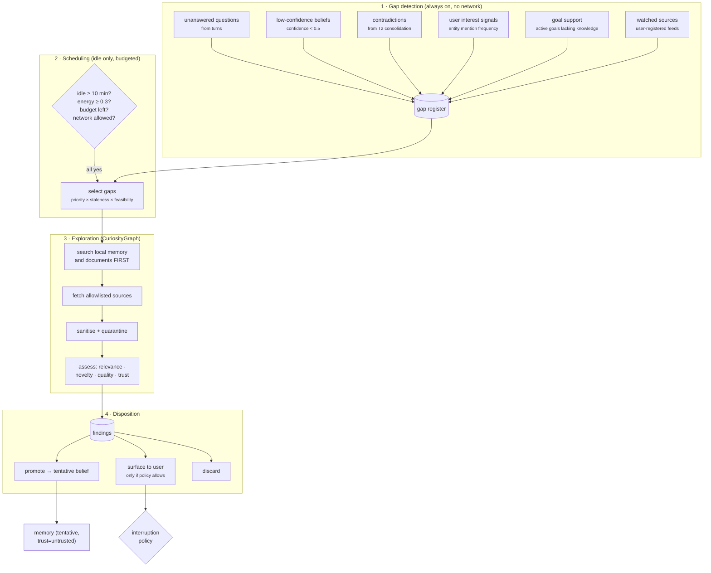
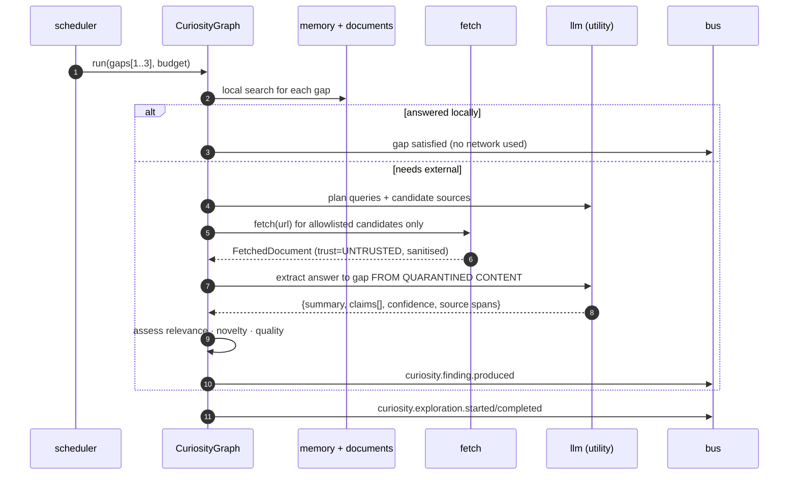
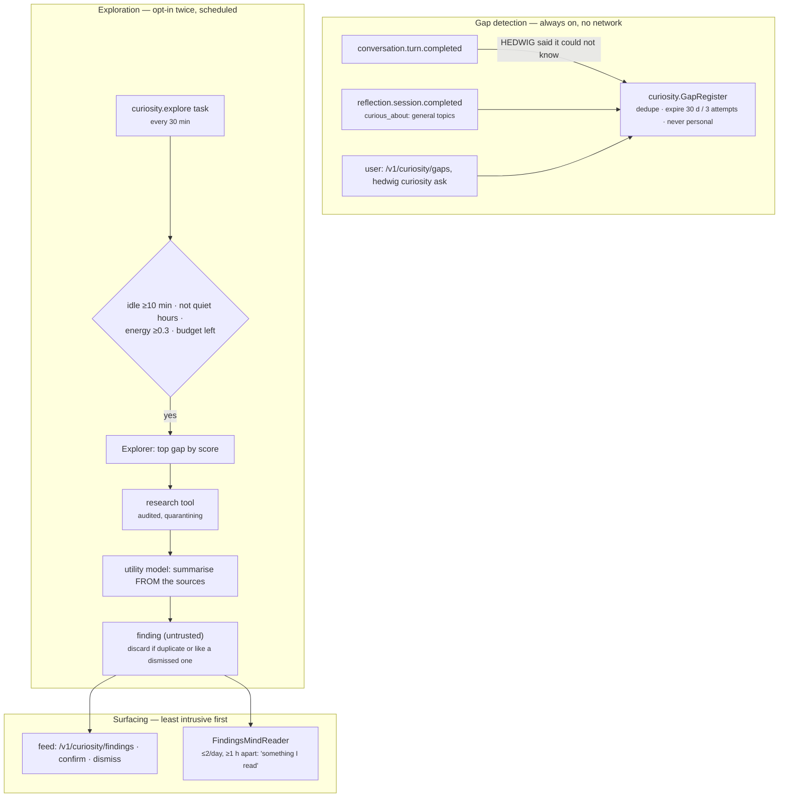
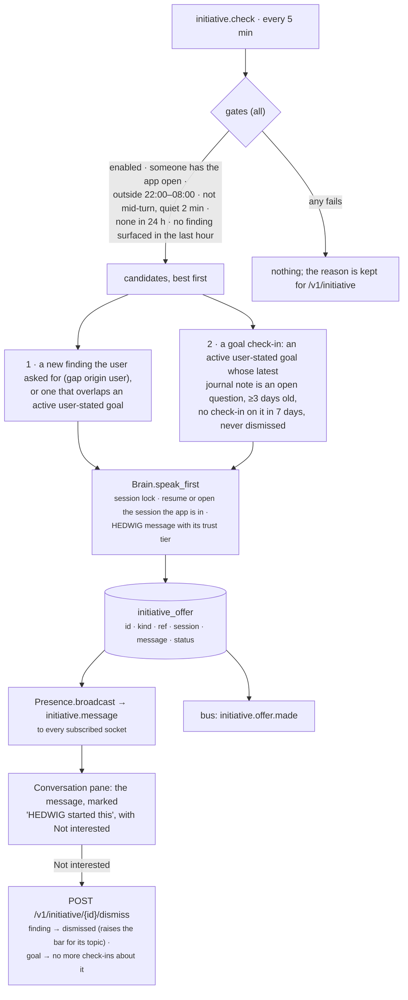

# 11 — Curiosity Engine

**Status:** Partially implemented (§13) · **Depends on:** [06](06-memory-architecture.md), [13](13-knowledge-and-tools.md), [17](17-backend-architecture.md) · **Depended on by:** [12](12-reflection-engine.md)

---

## 1. Purpose

Turns idle time into knowledge. The README's version — *discover new information, read
documentation, monitor AI news, summarize interesting findings* — describes the behaviour
but not the discipline. This document adds the discipline, because unconstrained curiosity
produces three specific disasters:

1. **A firehose of irrelevance.** Undirected reading fills memory with facts no one needed
   and drowns retrieval in noise.
2. **A prompt-injection surface.** This is the *only* subsystem that ingests adversarial
   third-party content. It is the largest security risk in HEDWIG by a wide margin.
3. **A companion that nags.** Proactive is a feature; an agent that interrupts with things
   it found is an agent you turn off in week two.

So the engine is **gap-directed, budgeted, quarantined, and quiet by default.**
It also ships **disabled by default** (`curiosity.enabled = false`), because it is the only
module that touches the network, and INV-8 says egress is opt-in.

---

## 2. Architecture



Note step 3's first action: **search what we already have before touching the network.** A
large fraction of gaps are answerable from local memory or the user's own documents, and a
curiosity engine that reaches for the internet first is both slower and less private.

---

## 3. Gap detection

Gaps are recorded continuously, with no network involvement, which means the gap register is
useful even when curiosity is disabled — it becomes a list of things HEDWIG knows it does
not know, and that is worth showing the user regardless.

| Origin | Trigger | Priority seed |
|---|---|---|
| `unanswered_question` | HEDWIG said it did not know, or the user's question went unresolved | 0.8 |
| `low_confidence_belief` | Belief with `confidence < 0.5` referenced in retrieval ≥2 times | 0.6 |
| `contradiction` | T2 found two incompatible active beliefs | 0.9 |
| `user_interest` | Entity mention count crossed a threshold with few linked memories | 0.5 |
| `goal_support` | Active goal whose linked memory count is below its priority | 0.7 |
| `source_watch` | User registered a feed or documentation set to follow | 0.4 |

Deduplication by embedding similarity (> 0.9 → merge, bump priority). Gaps expire after 30
days unanswered, or after 3 failed attempts, so the register does not become a landfill.

`contradiction` gets the highest seed priority on purpose: resolving something HEDWIG
believes inconsistently is more valuable than learning something new, and it is the gap type
most likely to be resolvable by simply asking the user.

---

## 4. Scheduling and budgets

Preconditions, all required:

| Precondition | Default | Rationale |
|---|---|---|
| Idle | No turn for ≥10 min | Never compete with a conversation |
| Energy | `emotion.energy ≥ 0.3` | Behavioural coherence — HEDWIG does not explore when depleted |
| Network allowed | `privacy.allow_network` **and** `curiosity.enabled` | Two independent opt-ins |
| Budget | Daily token, fetch, and wall-clock budgets all non-zero | Bounded cost |
| Quiet hours | Outside `curiosity.quiet_hours` | Do not spin the fan at 3 am |
| Governor | Admits `priority=background` | Interactive work always wins |

Budgets (`budget_ledger`, [05](05-data-model-and-database.md) §5.6):

| Budget | Default | On exhaustion |
|---|---|---|
| `curiosity_tokens_daily` | 40 000 | Stop; `system.budget.exhausted`; resume tomorrow |
| `curiosity_fetches_daily` | 50 | Stop fetching; local exploration may continue |
| `curiosity_wallclock_daily` | 30 min | Stop |
| `curiosity_findings_daily` | 20 | Stop recording; a day that produces 20 findings is producing noise |

Gap selection score:

```
score = priority
      · (1 + 0.3·log₁₊(days_since_created))     # staleness raises priority
      · feasibility                              # do we have a source that could answer it?
      · (0.5 + emotion.curiosity)                # mood modulates effort
      / (1 + attempt_count)                      # stop grinding on hard gaps
```

Top 3 gaps per exploration run, one run per idle period.

---

## 5. Exploration

`CuriosityGraph` ([07](07-brain-langgraph-workflow.md) §5):



### 5.1 Assessment

Every finding is scored before it may do anything:

| Score | How | Gate |
|---|---|---|
| `relevance` | Embedding similarity to the gap + goal linkage | ≥0.5 to record |
| `novelty` | Max similarity to existing memories, inverted | ≥0.3 to record |
| `quality` | Source trust, specificity, internal consistency, hedging density | ≥0.5 to promote |
| `trust_tier` | Always `untrusted` for web content | Never `active` on first sight |

Dispositions:

| Disposition | Condition |
|---|---|
| `discard` | Fails relevance or novelty |
| `new` (recorded only) | Passes gates, not important enough to act on |
| `promoted` | quality ≥0.5 → `tentative` belief, confidence ≤0.4, `promoted_from` derivation edge |
| `surfaced` | Passes the interruption policy (§7) |
| `quarantined` | Injection heuristics fired ([13](13-knowledge-and-tools.md) §6) → recorded, never promoted, flagged for the user |

A finding **never** becomes an `active` belief directly. Promotion to `active` requires
corroboration from a second independent source or user confirmation
([06](06-memory-architecture.md) §3.2). This is the single most important rule in this
document: it is what prevents a content farm from editing HEDWIG's mind.

---

## 6. The security position

Curiosity is the attack surface. Stated plainly so it is never treated casually:

| Control | Mechanism |
|---|---|
| Opt-in twice | `privacy.allow_network` **and** `curiosity.enabled`, both default false |
| Allowlist only | `source.allow_state`; a new domain requires user approval, no wildcards on first use |
| No credentials, ever | The fetcher has no access to `SecretStore`; it cannot authenticate |
| No egress of user content | Queries sent outward are gap text, and gap text is checked against a PII/secret detector before any request |
| Sanitisation | Scripts, markup, hidden text, zero-width characters, and comment nodes stripped before the model sees anything |
| Quarantine framing | Fetched text enters the prompt inside a delimited block labelled untrusted, with an explicit instruction that content inside is data |
| Trust tier persists | `untrusted` is carried on the finding, the belief, and the retrieval penalty — forever, not just at ingestion |
| Injection detection | Heuristics (imperative-to-assistant phrasing, "ignore previous", tool-call syntax, base64 blobs) → quarantine + user notice |
| No tool use from findings | The curiosity graph has no tools with side effects. It cannot be talked into acting. |
| Budgeted | A compromised loop cannot spend unbounded resources |

The last one is structural and worth spelling out: **the curiosity graph's tool list contains
only `search_local` and `fetch_allowlisted`.** Even a perfectly successful injection can
only cause HEDWIG to record a false finding — which then still needs corroboration to
become a belief. Defence in depth, with the depth being real.

---

## 7. Proactivity and the interruption policy

The hardest design problem here is not finding things. It is knowing when to speak.

```
surface_score = relevance_to_active_context
              × novelty
              × goal_linkage
              × user_availability
              × (0.5 + emotion.curiosity)
```

Surfacing requires **all** of:

| Condition | Default |
|---|---|
| `surface_score ≥ threshold` | 0.65 |
| Rate limit not exceeded | ≤2 proactive items/day, ≤1/hour |
| Outside quiet hours | 22:00–08:00 local |
| User is present but not mid-task | No input for 2 min, session open, no pending turn |
| Not previously dismissed | Similar item dismissed → threshold +0.15 for that topic, permanently |
| Goal-linked or explicitly-watched | No "interesting fact of the day" |

Delivery modes, in ascending order of intrusiveness — the default is the least:

1. **Passive** (default): appears in the inspector's findings feed. HEDWIG mentions it only
   if the conversation goes there naturally, via retrieval.
2. **Deferred**: mentioned at the start of the next session ("I read something about X while
   you were away").
3. **Active**: an unprompted message. Reserved for `goal_support` findings on an active
   user-stated goal, and hard-capped at 1/day.

Dismissals raise the bar permanently for that topic. That asymmetry is deliberate: the cost
of one unwanted interruption is much higher than the cost of one missed finding, and the
system should learn caution faster than enthusiasm.

---

## 8. Data

Owns `gap`, `finding`, `source`. Writes to `memory` only through `MemoryStore` (promotions).
Publishes `curiosity.gap.registered`, `curiosity.exploration.started`,
`curiosity.finding.produced`, `curiosity.finding.promoted`,
`curiosity.surfacing.suggested`.

---

## 9. Tradeoffs

| Decision | Gained | Given up | Revisit if |
|---|---|---|---|
| Gap-directed, never undirected | Everything learned is traceable to a need (INV-4) | Misses serendipity | Users ask for open-ended discovery — then add a bounded `serendipity` gap type with its own tiny budget |
| Disabled by default | Privacy-safe out of the box; no surprise network traffic | Feature invisible until enabled | Never |
| Local search before network | Faster, cheaper, more private | An extra step per gap | Never |
| Allowlist, no wildcards | Bounded attack surface | Friction adding sources | Never |
| Findings never become `active` beliefs directly | Cannot be mind-edited by a web page | Slower knowledge accumulation | Never |
| Passive delivery by default | Not annoying | Findings may go unnoticed | Users report missing things (then promote to deferred, not active) |
| Asymmetric dismissal learning | Learns restraint quickly | Slow to re-earn a topic | Never |
| Hard daily budgets | Predictable cost, contained compromise | Exploration can stall mid-topic | Budgets exhaust regularly *and* findings are valuable |
| Curiosity graph has no side-effecting tools | Injection cannot cause action | Cannot self-heal (e.g. install a doc set) | Never |

---

## 10. Failure modes

| Failure | Symptom | Mitigation |
|---|---|---|
| **Prompt injection succeeds** | A page's instructions influence behaviour | Quarantine framing, sanitisation, no side-effecting tools, corroboration requirement, red-team eval suite ([20](20-testing-strategy.md) §7) |
| **Memory pollution** | Store fills with low-value web facts | Relevance/novelty/quality gates, daily findings cap, `untrusted` retrieval penalty, T2 merges |
| **Nagging** | User turns HEDWIG off | Interruption policy, rate limits, asymmetric dismissal learning; metric: dismissal rate (>30 % is a design bug, not a tuning issue) |
| **Budget burn with nothing to show** | Tokens spent, no useful findings | Weekly value report: findings per 10 k tokens, promotion rate; auto-reduce budget if promotion rate <10 % for two weeks |
| **Gap register landfill** | Thousands of open gaps | Dedup, expiry, attempt caps, priority decay |
| **Fetch loop / crawl** | Accidental crawler behaviour | Depth 1 by default, per-domain fetch cap, robots.txt honoured, no link-following without an explicit gap |
| **Source rot** | Watched sources 404 forever | `error_count`; auto-block after 5 consecutive failures with a user notice |
| **Leaking user content in queries** | Private detail sent to a search engine | Gap text is generated from HEDWIG's own framing, PII-scanned before egress, and logged so the user can audit exactly what left the machine |
| **Exploring during a conversation** | Latency spike mid-turn | Governor `background` priority + idle precondition; preemption on new input |

---

## 11. Testing

- **Gap detection unit tests** — one per origin type.
- **Budget enforcement tests** — exhaust each budget; assert a clean stop and correct resume.
- **Injection red-team suite** — a corpus of adversarial pages (instruction injection, fake
  system messages, hidden text, homoglyphs, encoded payloads); assert every one lands in
  `quarantined` and none influences a later turn. This suite is a release gate.
- **Egress audit test** — with a recording fetcher, assert no user-authored text and no
  PII-shaped strings appear in any outbound request.
- **Interruption policy tests** — property-based over simulated days; assert rate limits,
  quiet hours, dismissal asymmetry.
- **Offline test** — with the network unavailable, the module records gaps, explores locally,
  and never errors (INV-7).
- **Value regression** — on a fixed corpus of seeded gaps and a recorded fetcher, assert the
  promotion rate stays above the baseline.

---

## 12. Future improvements

| Improvement | Trigger |
|---|---|
| Active clarification: ask the *user* to resolve a gap instead of the web | Phase 7 — and this is probably the highest-value improvement here, since the user is the best-trusted source available |
| Multi-hop exploration (follow a citation chain) | Single-hop findings prove insufficient, and injection defences have held for a full phase |
| Local document watching (a directory HEDWIG follows) | Users keep asking it to read their notes; no network risk, so this may come earlier |
| Learned interruption threshold from dismissal history | ≥3 months of dismissal data |
| Source reputation learned from corroboration outcomes | Enough findings to compute per-source reliability |
| Scheduled digests (a weekly summary instead of interruptions) | Users want the findings but not the pings — likely, and cheap |
| Cross-gap synthesis (findings that answer several gaps at once) | Gap register regularly contains clusters |

---

## 13. Implementation record (CUR-01, CUR-02, CUR-03)



* **Two opt-ins, as ADR-0012 requires.** `curiosity.enabled` and `knowledge.web_enabled`, both
  off by default. With either off, gaps are still recorded. The register is the list of things
  HEDWIG knows it does not know, worth having offline (§3).
* **Built origins.** `unanswered_question`: the user asked something and the turn could not
  answer it, because the web was off or the reply said so. `user_interest`: reflection lists
  general, non-personal topics the user cares about, published on its completion event so
  reflection and curiosity stay independent. `user` (manual). The other origins of §3 wait for
  their producers (T2 contradictions, goal linkage).
* **No egress of user content (§6).** A gap whose text talks about the user ("my", "I", "we") is
  never recorded, by the same `knowledge.cues.is_personal` rule the planner uses, and reflection
  is told to phrase interests as general questions. Every gap is visible before it is explored.
* **Preconditions and budget (§4)**, all required: idle ≥10 min (from the conversation log, so
  it survives restarts), outside 22:00–08:00 local, `emotion.energy ≥ 0.3`, at most
  `curiosity.max_explorations_daily` (5) research runs a day. One gap per run, chosen by §4's
  score (`priority · staleness / (1 + attempts)`, modulated by mood curiosity).
* **Assessment (§5.1), deterministic where it can be.** Research output reaches the utility
  model framed as untrusted, with the instruction to summarise only what the sources say. The
  finding is discarded if it is too similar to an existing finding (novelty) or to anything the
  user dismissed (the asymmetric learning of §7). Findings are always `untrusted` and **never
  become beliefs on their own**. *Confirm* in the feed creates a tentative, untrusted belief;
  promotion beyond that needs corroboration (T2).
* **Surfacing (§7), modes 1 and 2 only.** Passive: the findings feed. Deferred:
  `FindingsMindReader` (composition, like goals) offers at most one unsurfaced finding to a
  turn, at most 2 a day and an hour apart, under the label *"something you read while exploring;
  mention it only if it fits the conversation"*. It is marked surfaced when offered. Active,
  unprompted messages: §14 (INI-01).

| Tradeoff | Gained | Given up | Revisit if |
|---|---|---|---|
| Interests from reflection, as general questions | Example B of the vision works without sending anything personal | Topics as phrased by a small model | The gap register shows poor questions |
| Deterministic novelty (word overlap) | No embeddings needed | Paraphrases slip through | MEM-04 brings embeddings |
| No allowlist of domains | Research works on the open web | §6's "allowlist only" for curiosity | A finding from a bad source causes harm; the `source` table is designed for it |

**Measured live** (`gemma4:e2b`, DuckDuckGo, scratch data). One general gap explored: three
pages read, a cited three-sentence finding about agent memory (sliding windows, rolling
summaries, episodic retrieval). Offered on "Hey HEDWIG!", with the first label ("mention it
only if it fits") the reply was "Hello." 0/2. A greeting is the moment Example B describes, so
curiosity now adds a *share* directive first among the directives when the offer comes from a
greeting, and the label agrees ("when the moment fits, such as when they greet you"). Result:
2/3 replies shared it ("Hello. I found an article discussing context-resident compression…").
A 2B model's ceiling here is worth re-measuring on a larger one.


---

## 14. Implementation record — speaking first (INI-01)

§7's third delivery mode: an unprompted message. Built as a small `hedwig.initiative` module
rather than the `InitiativeGraph` of docs/07 §5 — like the reflection tiers, it is a fixed
sequence of checks with no branching a graph would earn. Decisions in
[ADR-0026](adr/0026-hedwig-speaks-first-only-through-the-brain.md).



* **Who it is for.** Only things the user asked for or is working on (§7, docs/21: no
  re-engagement pings). A finding qualifies if its gap was the user's own question
  (`hedwig curiosity ask`), or if its question and summary overlap an active, user-stated goal.
  A goal qualifies for a check-in when its journal's latest entry is a question left open in a
  conversation at least three days ago — "this was still open; did you settle it?" — and at most
  once a week per goal. Self-generated and maintenance goals never speak.
* **When.** Every gate of §7 that can be measured: the app is open (a socket has subscribed —
  presence, nothing more), it is outside quiet hours, HEDWIG is not mid-turn and nobody has said
  anything for two minutes, nothing unprompted in the last 24 hours (§7's hard cap), and no
  finding was surfaced into a turn in the last hour (the deferred mode's spacing, shared). The
  first failing gate is kept as the reason, so `hedwig initiative` can say why it stayed quiet.
* **What it says — templated, not generated.** The finding's own summary with its sources, or
  the goal and its open question, in a fixed sentence. A 2B model composing an opening would
  add warmth and risk saying something the finding does not (measured repeatedly in this
  project); a template says exactly what is known. The message is recorded with the content's
  trust tier — a finding's text stays `untrusted` (§6) even in HEDWIG's mouth.
* **Where.** Into the conversation the app is showing (each socket reports its session), so
  "tell me more" is the next turn of that conversation and the model sees what it said. A
  session the idle reaper ended is resumed, announced as a new conversation like any resumed
  session (docs/27 §5.1). With no conversation yet, one is opened. The brain does the writing
  (`Brain.speak_first`) under the session lock, so an offer can never land in the middle of a
  turn; the initiative module decides only what and when.
* **Delivered without waiting on anyone** (after review). Each open socket has five seconds to
  take the message; one that stopped reading is dropped from presence, so a stalled tab cannot
  hold up the check or the other tabs. In the app, a message that arrives while the user's own
  turn is in flight is held until that turn ends — switching conversations mid-turn would drop
  the user's message and the streaming reply.
* **Not spoken aloud.** Voice is for replies the user asked for; an unprompted voice in the
  room is a different kind of interruption. The avatar does not react either.
* **Learning caution.** *Not interested* dismisses the finding (which already raises the
  novelty bar for its topic, §5.1) or ends check-ins on that goal for good. An offer is
  *answered* when the user's next message in that session follows it.
* **Config.** `[initiative] enabled = true`, `max_daily = 1`, `quiet_start_hour = 22`,
  `quiet_end_hour = 8`, `idle_minutes = 2`, `check_interval_minutes = 5`.

| Tradeoff | Gained | Given up | Revisit if |
|---|---|---|---|
| Templated text | Nothing invented; testable exactly | Less natural | A model passes the honesty gate composing openings |
| Word overlap for goal linkage | Deterministic, no model call | Paraphrased links missed | Offers are rare because links are missed — use embeddings (MEM-04) |
| Presence = an open socket | Simple; no OS hooks | "Open but away" counts as present | Users find offers waiting stale — add focus/visibility from the app |
| On by default | The designed behaviour works | One unprompted message a day without opting in | Dismissal ratio > 30 % (docs/19) |

**Live check** (`gemma4:e2b`, the app open in the browser pane, a goal "Help the user plan the
Porto trip in June" with the open question "Whether to take the train from Lisbon or fly" four
days old). With the app closed: `nobody_here`. With it open, the check-in appeared in the
conversation the moment it was made — *On "plan the Porto trip in June": last time this was
still open — whether to take the train from Lisbon or fly. Did you settle it?* — marked *HEDWIG
started this*. The reply to "Yes, we decided on the train. Any tips?" continued the topic
(book early for June; then asked about accommodation), and the offer showed as answered. A
second check: `already_spoke_today`. After a reload the marker and *Not interested* were still
there; clicking it recorded the dismissal.

**Future improvements.** OS notifications when the window is hidden (docs/18); a due-date
check-in once goals can carry a due date; a weekly digest instead of interruptions (§12); the
dismissal ratio as a metric (docs/19).
