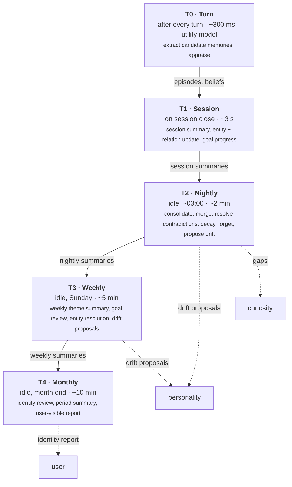
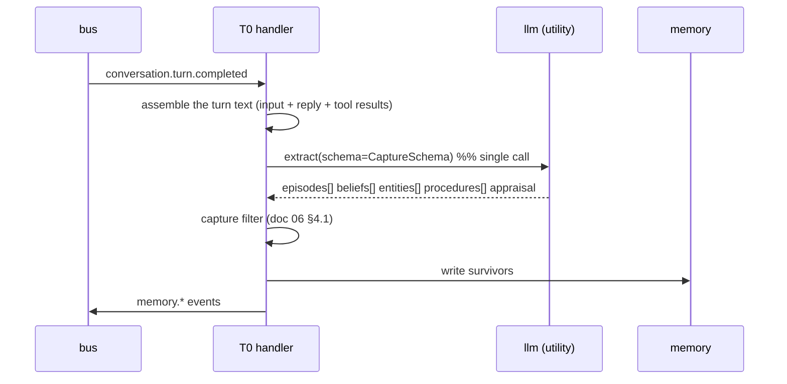
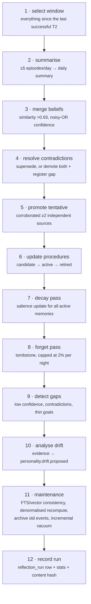
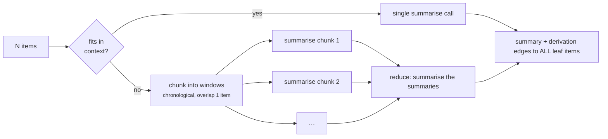
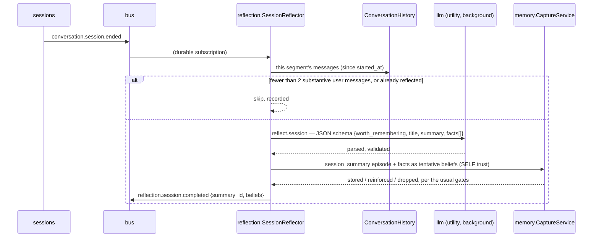
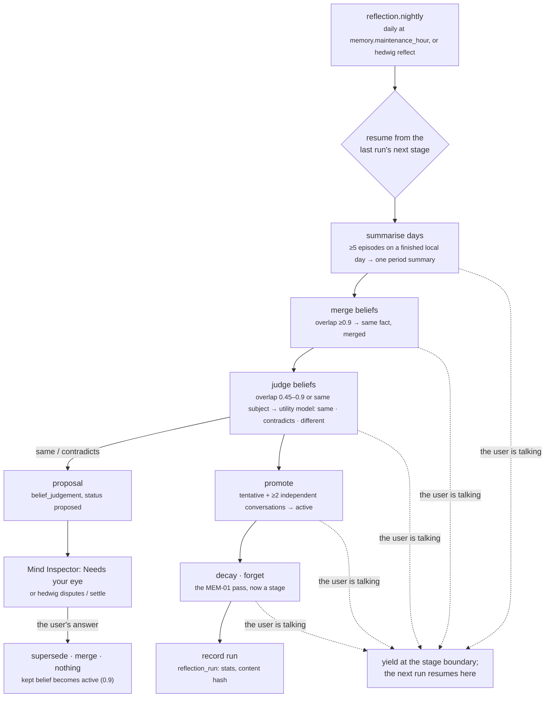
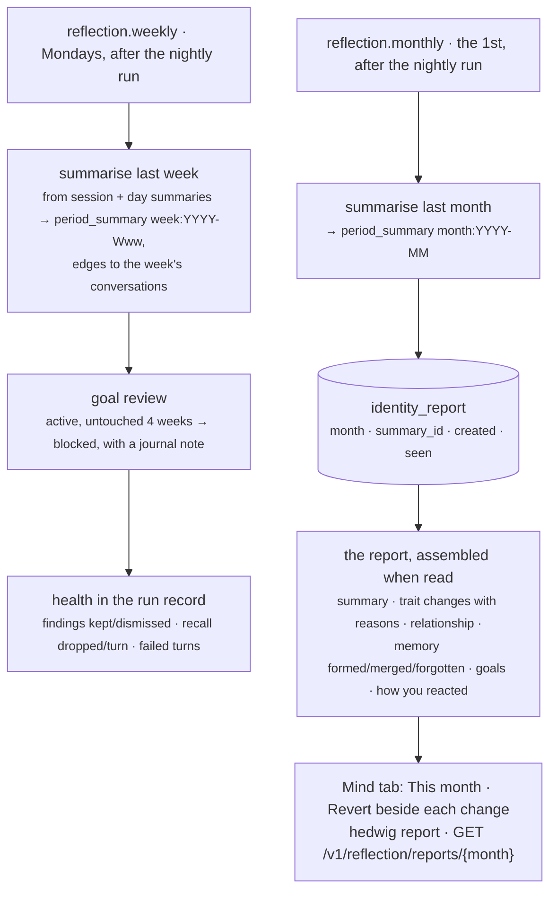

# 12 — Reflection Engine

**Status:** Partially implemented (§14: T1, §15: T2) · **Depends on:** [06](06-memory-architecture.md), [08](08-state-management.md), [10](10-personality-engine.md) · **Depended on by:** [17](17-backend-architecture.md)

---

## 1. Purpose

Reflection is where raw experience becomes knowledge, where memory is pruned, and where
personality change is proposed. It is the process that makes HEDWIG's memory *organised*
rather than merely *large* — and organisation, not capacity, is what makes recall work.

If retrieval is the highest-leverage read path, reflection is the highest-leverage write
path. It is also the least visible subsystem, which is why it gets the most instrumentation.

---

## 2. Five tiers

One reflection process at five timescales. The tiering exists because the useful unit of
consolidation differs by horizon: a turn yields facts, a week yields themes, a month yields
identity.



| Tier | Trigger | Runs in | Interruptible | Idempotency key |
|---|---|---|---|---|
| T0 | `conversation.turn.completed` | Event handler | No (it is short) | `turn_id` |
| T1 | `conversation.session.ended` | Job | Yes, resumable | `session_id` |
| T2 | Scheduler, idle after 02:00 | Job (ReflectionGraph) | Yes, cursor-based | `date + input content hash` |
| T3 | Scheduler, idle Sunday | Job | Yes | `iso_week + hash` |
| T4 | Scheduler, idle on the 1st | Job | Yes | `month + hash` |

---

## 3. T0 — Turn reflection

The only tier on the interactive path's heels, so it is strictly bounded: **one utility-model
call, one schema, no retrieval, no writes to mind state.**



`CaptureSchema` (structured output, validated):

```json
{
  "worth_remembering": true,
  "episodes":   [{"title": "...", "content": "...", "importance": 0.7,
                  "emotional_charge": 0.2, "entities": ["..."]}],
  "beliefs":    [{"statement": "...", "confidence": 0.6, "subject": "user",
                  "predicate": "prefers", "object": "concise answers"}],
  "entities":   [{"name": "...", "kind": "project"}],
  "procedures": [{"trigger": "...", "action": "...", "evidence": "..."}],
  "appraisal":  {"novelty": 0.4, "goal_congruence": 0.6, "certainty": 0.8,
                 "agency": 0.0, "social_valence": 0.3, "effort": 0.2, "norm_fit": 0.9}
}
```

One call producing both capture and appraisal is deliberate: they need the same input, and
two calls would double the cost of the most frequent cognitive operation in the system.

`worth_remembering: false` short-circuits everything — the common case for "thanks" and
"ok".

---

## 4. T1 — Session reflection

On session close (explicit, timeout, or recovered-orphan):

| Step | Output |
|---|---|
| Assemble session transcript + T0 episodes | — |
| Summarise (map-reduce if > context window) | One `session_summary` episode, `summarised_from` edges to member episodes |
| Update entities | `mention_count`, aliases, new entities |
| Update relations | `familiarity`, `affinity`, `trust` per [06](06-memory-architecture.md) §3.3 |
| Assess goals | `goals.goal.progressed` / `closed` events |
| Compute session mood arc | Stored in the summary's metadata for later theme analysis |
| Link summary to session | `session.summary_id` |

Relationship updates happen here, not per turn, so that relationships move with the shape of
a conversation rather than with its last sentence.

---

## 5. T2 — Nightly consolidation

The heaviest tier and the one that keeps the store healthy. Runs as `ReflectionGraph`
([07](07-brain-langgraph-workflow.md) §5), cursor-resumable at every stage.



Ordering is not arbitrary and should not be rearranged casually:

- Summarise **before** decay, so summaries exist before their sources start fading.
- Merge **before** contradiction resolution, so near-duplicates do not look like conflicts.
- Promote **before** forgetting, so a memory that is about to become important is not
  dropped the night before.
- Forget **after** gap detection, so a forgotten memory can still have registered the gap it
  implied.

### 5.1 Resource discipline

T2 is the main threat to the "background never starves conversation" rule
([17](17-backend-architecture.md) §7):

| Control | Value |
|---|---|
| Governor priority | `background`, preemptible at any stage boundary |
| Model lock | Yields immediately when interactive work arrives |
| Token budget | 60 000/night; stages beyond the budget defer to the next night |
| Wall-clock budget | 15 min; the cursor persists |
| Batch size | 20 items per model call, so preemption granularity stays fine |

If a user starts typing at 03:07, T2 stops at the current batch boundary within a second or
two and resumes the following night from its cursor. That is the whole reason for
cursor-per-stage rather than run-to-completion.

### 5.2 Idempotency

Every run records `content_hash` over its input set. A re-run with the same inputs is a
no-op. Each stage is separately idempotent:

| Stage | Idempotency mechanism |
|---|---|
| Summarise | One summary per (period, kind); existing → skip |
| Merge | Merging already-merged beliefs is a no-op (loser is tombstoned) |
| Promote | Already-active → skip |
| Decay | Keyed on `last_decay_at`; applying twice in one day is prevented by the timestamp, not by luck |
| Forget | Already-tombstoned → skip |
| Drift proposals | Deduplicated by (trait, evidence set hash) |

Decay is the one that would silently corrupt state if it double-applied — hence an explicit
`last_decay_at` rather than "the job runs once a night, so it's fine".

---

## 6. T3 — Weekly review

| Step | Output |
|---|---|
| Theme extraction over the week's daily summaries | `period_summary` episode with themes |
| Goal review | Stale `active` goals → `blocked`; `proposed` goals expired; priorities rebalanced |
| Entity resolution | Merge duplicate entities (`merged_into`, non-destructive) |
| Relationship trajectory | Longer-horizon `affinity`/`trust` adjustment |
| Drift analysis | Higher-confidence proposals from a week of evidence |
| Curiosity value report | Findings per token, promotion rate; may auto-reduce budgets |
| Retrieval health report | recall proxies, `dropped_count` trends, index consistency |

Entity resolution sits at T3 rather than T2 because it needs enough mentions to be
confident, and a wrong merge is expensive to unpick.

---

## 7. T4 — Monthly identity review

The tier that makes growth legible to the user, and the only reflection tier with
user-visible output by default.

| Step | Output |
|---|---|
| Monthly `period_summary` | "What this month was about" |
| Trait diff | Every applied change with its evidence |
| Relationship diff | Familiarity/affinity/trust trajectory |
| Memory statistics | Formed, merged, forgotten; store size |
| Goal outcomes | Completed, abandoned, still open |
| Self-assessment | Where HEDWIG was useful, where it failed, from feedback data |
| **Identity report** | A user-facing document, and a prompt to confirm or revert drift |

The identity report is not a nicety. A system that changes itself over time and never says
how has crossed from adaptive into opaque, and opacity in something you talk to daily is
where trust dies. It is also the natural consent point for identity-core changes
([10](10-personality-engine.md) §3.2).

---

## 8. Summarisation mechanics

Map-reduce, since sessions can exceed the context window:



Rules:

- **Derivation edges always point to leaf items**, not to intermediate chunk summaries. The
  intermediates are discarded. Otherwise the lineage graph fills with scaffolding.
- **Chronological chunking with one item of overlap** preserves narrative continuity across
  chunk boundaries.
- **Summaries are extractive-biased**: the prompt requires that specifics (names, decisions,
  numbers) survive, because a summary that keeps only the gist is the fastest way to destroy
  a memory system's value. This is checked by an eval that asserts named entities in the
  input appear in the output.

---

## 9. Data

Owns `reflection_run` and `drift_proposal` creation. Writes memory only via `MemoryStore`,
mind state only via events and the personality module's decision path. Reads everything.

---

## 10. Tradeoffs

| Decision | Gained | Given up | Revisit if |
|---|---|---|---|
| Five tiers | Right consolidation unit per horizon | Five code paths | A tier stops earning its cost — most likely T3 |
| T0 as an event handler, not a job | Immediate capture, no queue latency | Slight coupling to bus timing | Capture lag becomes visible |
| One combined capture+appraisal call | Halves the cost of the most frequent operation | The two concerns are coupled in one schema | Schema grows unwieldy |
| Cursor-resumable stages | Preemptible; never blocks the user | More bookkeeping | Never |
| Nightly batch decay | Cheap pure reads, inspectable | Salience up to 24 h stale | Retrieval quality suffers measurably |
| Summaries do not delete sources | Lineage preserved; sources decay naturally | More storage | Storage becomes a real constraint |
| Reflection proposes drift, personality decides | Guardrails are external to the proposer | Two modules per concept | Never |
| T4 user-visible report | Trust, consent, legibility | Effort; a report nobody reads is wasted | Users ignore it (then make it shorter, not absent) |
| Extractive-biased summaries | Specifics survive | Longer summaries | Token pressure |

---

## 11. Failure modes

| Failure | Symptom | Mitigation |
|---|---|---|
| **Summary drift / telephone game** | Monthly summaries bear little relation to what happened | Derivation edges to leaves, extractive bias, entity-preservation eval, originals never deleted |
| **T2 never completes** | Store degrades silently | `reflection_run` monitoring; 3 consecutive incomplete nights raises a user-visible notice |
| **T2 starves the conversation** | Latency spike at night | Governor preemption, batch granularity, latency metric per priority class |
| **Double decay** | Memories fade twice as fast | `last_decay_at` guard; property test |
| **Mass forgetting** | Memories vanish | 2 %/night cap, tombstones reversible, forgotten-count alert |
| **Contradiction ping-pong** | A belief flips nightly | Supersession requires equal-or-better provenance; repeated flips register a gap and stop trying |
| **Bad merge** | Two distinct facts become one wrong fact | Similarity threshold 0.93, `merged_from` edges, restorable tombstones, merge-precision eval |
| **Runaway drift proposals** | Dozens per night | Evidence thresholds at the proposer, plus seven guardrails at the decider |
| **Utility model degradation** | Garbage summaries | Schema validation, entity-preservation check, quality sampling in the weekly report |
| **Reflection while the DB is busy** | `SQLITE_BUSY` | Governor pauses on lock contention; batches are short transactions |

---

## 12. Testing

- **Per-tier unit tests** — with recorded model responses, assert exact writes.
- **Idempotency tests** — every tier run twice produces identical state. This is the single
  most valuable test in this subsystem.
- **Resumption tests** — kill at each stage boundary; assert the resumed run completes and
  the result equals the uninterrupted run.
- **Preemption test** — inject interactive load mid-T2; assert yield within 2 s and a correct
  resume.
- **Long-horizon scenario** — `FakeClock` simulates 90 days with a realistic turn
  distribution; assert store size bounded, important memories survive, trivia does not,
  drift within caps, no orphaned lineage.
- **Summary fidelity eval** — named entities and decisions from the input appear in the
  summary; a fixed corpus with a regression baseline.
- **Merge precision eval** — a labelled set of belief pairs; assert precision ≥0.95 (recall
  matters less than not merging distinct facts).
- **Budget tests** — exhaust the token budget mid-run; assert clean deferral.

---

## 13. Future improvements

| Improvement | Trigger |
|---|---|
| Dream-style recombination: generate hypotheses by combining distant memories | After T2 is stable and cheap; genuinely interesting, and low-risk since output is `tentative` |
| Self-critique: reflect on where HEDWIG's answers were wrong, using feedback | Feedback volume supports it (~200 signals) |
| Learned salience model from access patterns | ≥6 months of access data |
| Adaptive tier scheduling (reflect more after busy days) | T2 regularly hits budget limits |
| Incremental summarisation (update a summary rather than rewriting) | Summarisation dominates the nightly token budget |
| Cross-session narrative arcs ("the month we redesigned retrieval") | T4 output proves valuable to the user |
| Collapse T3 into T2 with a weekly flag | If T3 proves not to earn its own code path |

---

## 14. Implementation record — T1 session reflection (REF-01)

Before this, semantic memory (beliefs) was built, tested and never written outside the test
suite: capture stored each exchange verbatim and nothing distilled it (docs/29 G3). T1 is the
first thing that does.



* **Built:** summary episode (`session_summary`, with `summarised_from` edges to the session's
  interaction episodes) and belief extraction. **Not yet:** entity updates, goal assessment and
  the mood arc (docs/12 §4). Each needs a consumer that does not exist yet.
* **Facts are HEDWIG's inference, labelled as such.** A belief extracted by a model from what the
  user said is not the user's word: `trust = self`, `status = tentative`, confidence capped at
  0.5 (capture's own cap for every new belief), `source_ref = session:<id>`, `model_id` recorded. This is the "distinguish verified facts
  from hypotheses" line of the vision. Only a user correction (MEM-03) or corroboration across
  sessions (T2) should raise one.
* **Only what the user stated.** The prompt asks for durable facts about the user that the
  *user* said: preferences, people, projects, plans. HEDWIG's own replies are context, never a
  source. Small talk yields `worth_remembering: false` and nothing is written.
* **One call, background priority, typed default.** On a 1-model-at-a-time Ollama this queues
  behind interactive work (`RequestPriority.BACKGROUND`). If the model is unavailable or the
  output never validates, the reflection is skipped and logged. A missing summary is better than
  an invented one (docs/14 §6).
* **Idempotent per segment.** A session resumed after it ended is a new segment (docs/27 §5.1)
  and gets its own reflection. A redelivered `session.ended` for a segment already summarised
  writes nothing, because the reflector checks for a summary episode in that segment first, and
  the bus ledger stops most redeliveries anyway.

| Tradeoff | Gained | Given up | Revisit if |
|---|---|---|---|
| Reflect on session end, not per turn (T0) | One model call per conversation, not per message | A fact said in a session that never ends is captured only when the idle reaper ends it (30 min) | Recall needs facts mid-session |
| Tentative, capped, `self` trust | A model's misreading cannot masquerade as the user's word | True facts start weak until corroborated | T2 corroboration lands and promotes them |
| Utility model | Cheap, background | A 2–4B model's extraction quality | The `reflects a session` eval shows misses |

**Measured live** (`scripts/eval_models.py`, *reflects a session*, `gemma4:e2b`). Three facts
stated, conversation ended. With `reflect.session.v1`, 0/3: every fact was extracted, but
copied in the first person ("My favourite tea is…"), which stored reads as HEDWIG talking about
itself. `v2` adds a worked example, and `third_person()` rewrites a first-person opening
deterministically as a guard ("I live in Porto" becomes `The user said: "I live in Porto."`
rather than guessing verb agreement). Result: 3/3 runs, all three facts each time, all in the
third person; the reflection takes 1–3 s after the end.

---

## 15. Implementation record — T2 nightly consolidation (REF-02a/b/c)

REF-02 was split before starting. Built: the nightly run and the stages that act on what HEDWIG
already records. Deferred, each waiting for something that does not exist yet: procedures (no
procedural memory), drift analysis (PER-02), FTS/vacuum maintenance, and the weekly and monthly
tiers T3 and T4. (Drift analysis has since landed as the `drift` stage, PER-02 — docs/10 §13; T3 and T4 as
REF-03 — §16.)



* **A plain stage list, not a LangGraph graph.** docs/12 §5 names a `ReflectionGraph`. The run is
  linear, every stage is idempotent, and resumption needs one thing: which stage is next. That
  is a column on `reflection_run`, so a graph and a checkpointer would add a framework without a
  benefit (CLAUDE.md: no frameworks without one). If T2 ever branches, it becomes a graph.
* **Yielding.** Before every stage the run checks whether the user has spoken in the last two
  minutes. If so it stops with `status = yielded` and the next stage recorded, and the next run
  starts there (§5.1).
* **Summarise.** A finished local day with five or more conversation episodes gets one
  `period_summary` episode, `source_ref = day:YYYY-MM-DD`, with `summarised_from` edges to every
  leaf (§8). The prompt requires names, decisions and numbers to survive. One per day: an existing
  summary means skip. No model means the day waits for the next night.
* **Merge, judge, supersede.** Beliefs are compared pairwise by word overlap. At 0.9 or above
  they are the same fact: the older one stays, its confidence combines the two by noisy-OR
  (still capped while tentative), the newer one is tombstoned as `merged`, and a `merged_from`
  edge (plus `corroborated_by` when the two came from different conversations) records it.
  Between 0.45 and 0.9 the pair is about the same subject but may say different things ("sister
  lives in Porto" vs "… in Lisbon" overlap at 0.75), so word overlap cannot decide it. Pairs below
  0.45 that share two content words, or open with the same three words when the third is not a
  generic verb ("The user works…" yes, "The user is…" no), are judged too. These go to the
  utility model in one batched call, and every verdict is kept in `belief_judgement` so no pair
  is judged twice.
* **The model proposes; the user decides.** A *same* or *contradicts* verdict is stored as a
  proposal and changes nothing. The Memory tab of the Mind Inspector shows open proposals under
  *Needs your eye* (also `hedwig disputes`, `hedwig settle <pair> <choice>`, and
  `GET /v1/reflection/disputes`, `POST /v1/reflection/disputes/{pair}/resolve`). The user answers
  *first is true* / *second is true* (the other is superseded, both kept, `contradicted_by`
  edge), *same thing* (merged as above) or *both are true* (nothing changes). The user's answer
  is the strongest corroboration there is, so the belief they keep becomes `active` at 0.9. A
  pinned belief is never superseded: the answer is refused with "unpin it first", and the
  proposal stays open. `reflection.auto_apply_judgements = true` restores acting on the model's
  word alone (newer supersedes older, *same* merges) for a model that has been measured to
  deserve it.
* **Promote.** A tentative belief whose own conversation plus the conversations of the beliefs
  merged into it number two or more is promoted to `active` (confidence 0.7). This is the
  corroboration rule of docs/06 §3.2 and docs/11 §5.1. Its trust tier never changes: a web fact
  corroborated by two sites is an active *untrusted* belief.
* **Decay and forget** are the MEM-01 pass, moved in. The standalone `memory.maintenance` task is
  removed (docs/06 §7 said it would be). Their idempotency is unchanged (`last_decay_at`).
* **Record.** One `reflection_run` row per run: stats per stage (the judge stage reports
  `awaiting_you`), the next stage if it yielded, and a hash of the beliefs and episodes it read,
  for audit.

### 15.1 Why the model only proposes — measured

The first version applied verdicts directly. Measured live on `gemma4:e2b` (the default utility
model), that was not safe:

* With worked examples in the prompt it scored 4/4 — on pairs that *were* the examples. On
  held-out pairs, two runs answered "different" to everything and then "contradicts" to
  everything. The 4/4 was overfitting, not judgement.
* After the prompt and candidate changes above, on six held-out pairs (two runs, identical
  answers): Berlin/Munich and Sam/Alex correctly *contradicts*; "plays the guitar" / "plays the
  piano" wrongly *contradicts*. Applied, that verdict would have erased a true memory.
* The candidate rule used to pair "is vegetarian" with "is studying chemistry" (same opening
  words). Generic verbs are now excluded and that pair is no longer judged.
* Pairs that mean the same in different words ("is vegetarian" / "does not eat meat", "runs
  every weekend" / "goes running on Saturdays and Sundays", overlap 0.29 and 0.20) are not found
  at all. Word overlap cannot see them; embeddings can (future work below).

A wrong proposal costs the user one click. A wrong supersession silently rewrites what HEDWIG
believes about them. The asymmetry decides it.

| Tradeoff | Gained | Given up | Revisit if |
|---|---|---|---|
| Rules decide the clear cases, the model only the ambiguous middle | Cheap, testable, and no model call for identical facts | A 2B model's judgement on the rest | The judgement eval shows errors |
| Model verdicts are proposals, not actions | No true memory is rewritten on a 2B model's guess | Duplicates and outdated facts wait for the user; unanswered ones stay | A utility model passes the held-out judgement eval: set `auto_apply_judgements` |
| On the user's answer, the kept belief supersedes the other | Facts that change are updated, by the person who knows | One click per conflict | — |
| Verdict cache | Never pays twice for a pair | A pair judged "different" stays so | A belief is edited (MEM-03 clears its verdicts) |

**Future improvements.** Candidate pairs by embedding similarity, so paraphrases are found
(MEM-05/MEM-04 bring embeddings); a held-out judgement scenario in `scripts/eval_models.py` that
gates `auto_apply_judgements`; proposals that expire when one side is edited or forgotten
(MEM-03); a badge on the Memory tab when something needs the user's eye.

### 15.2 Found end to end: reflection was timing out (2026-11-23)

A full run of the app — talk, end the conversation, look at memory — showed no summary and no
beliefs. Session reflection sends a whole conversation through the utility model; with the
journal field it now writes (docs/08 §13) that took longer than the event bus's 30-second
handler default on gemma4:e2b, so every attempt timed out and retried. The bus port now declares
the per-subscription `timeout` the in-process bus already supported; reflection takes ten
minutes, the embedding subscriber two. Re-run: reflection finished 15 s after the conversation
ended, with a summary and three correct beliefs. Scripted tests could not see this — a recorded
model answers instantly.


---

## 16. Implementation record — T3 weekly and T4 monthly (REF-03)



* **Weekly (T3).** A summary of last week's themes from that week's conversation and day
  summaries, linked to the conversations themselves (§8: edges to leaves, never to other
  summaries). A goal review: an active goal untouched for four weeks becomes *blocked*, with a
  journal note saying why — the user can activate it again with one click, and nothing else
  about it changes. And the week's health in the run record: findings kept and dismissed, recall
  candidates dropped per turn, failed or truncated turns. Each part yields to a conversation in
  progress, like the nightly run, and runs once per week (`reflection_run`, tier `T3`).
* **Monthly (T4) — the identity report.** Last month summarised the same way, and an
  `identity_report` row naming the month and its summary. **The report is assembled when it is
  read**, from the live tables: what the month was about, every personality change with its
  reason and a *Revert*, where the relationship stands and how many turns there were, memories
  formed, merged and forgotten, goals finished, dropped and started, and how the user reacted to
  HEDWIG's manner. Assembling it at read time means an erased memory leaves past reports too,
  and a change reverted after the fact shows as reverted — a frozen copy would quietly keep
  both.
* **When the summaries are thin.** A period summary is written from the period's conversation
  and day summaries; with fewer than two, from the exchanges themselves (at least three). Found
  live on `gemma4:e2b`: three conversations in a month, one of which got a session summary (the
  others failed schema validation) — the month went unsummarised until the fallback. A week or
  month with fewer than three exchanges is recorded as `too_little_to_summarise`.
* **Scheduling.** Both are daily tasks one hour after the nightly run that do nothing unless last
  week's or last month's run is still to do (`reflection_run`): a missed Monday or 1st — laptop
  closed — is caught up the next day, and a first start never writes a report for a month before
  HEDWIG knew the user.
* **Live check** (`gemma4:e2b`, three conversations across a simulated October): the October
  report held a correct paragraph on the month (the compiler, the sister in Lisbon, the Porto
  trip, Portuguese lessons, the request to be concise), the verbosity change with its reason, 3
  conversations and 7 turns, 8 episodes and 1 belief formed, and the goal started.
* **Deferred, with reasons:** entity resolution (there are almost no entities to resolve yet),
  relationship trajectory (only the current relation is kept, no history to trace), and a
  model-written self-assessment (measured repeatedly in this project: a 2B model's judgement of
  itself would read as authoritative and is not — the report shows the user's own reactions
  instead).

| Tradeoff | Gained | Given up | Revisit if |
|---|---|---|---|
| Report assembled at read time | Purge and revert stay true in past reports | A report can change after the month | Users want an immutable record (export one) |
| Stale goals blocked, not abandoned | Nothing is lost; one click undoes it | A long-paused project shows as blocked | Users find it nagging |
| No model self-assessment | Nothing in the report is invented | Less narrative | A utility model passes a held-out honesty check for it |
