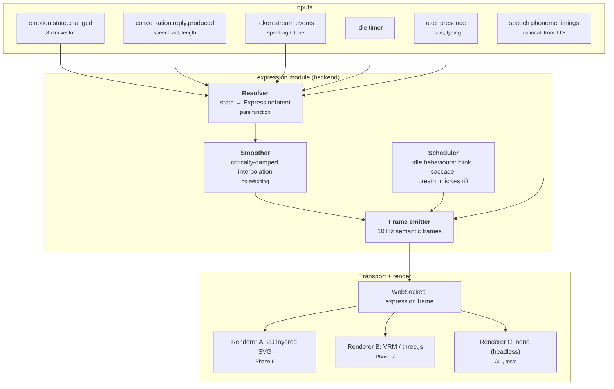
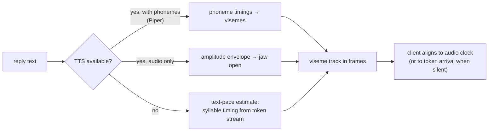
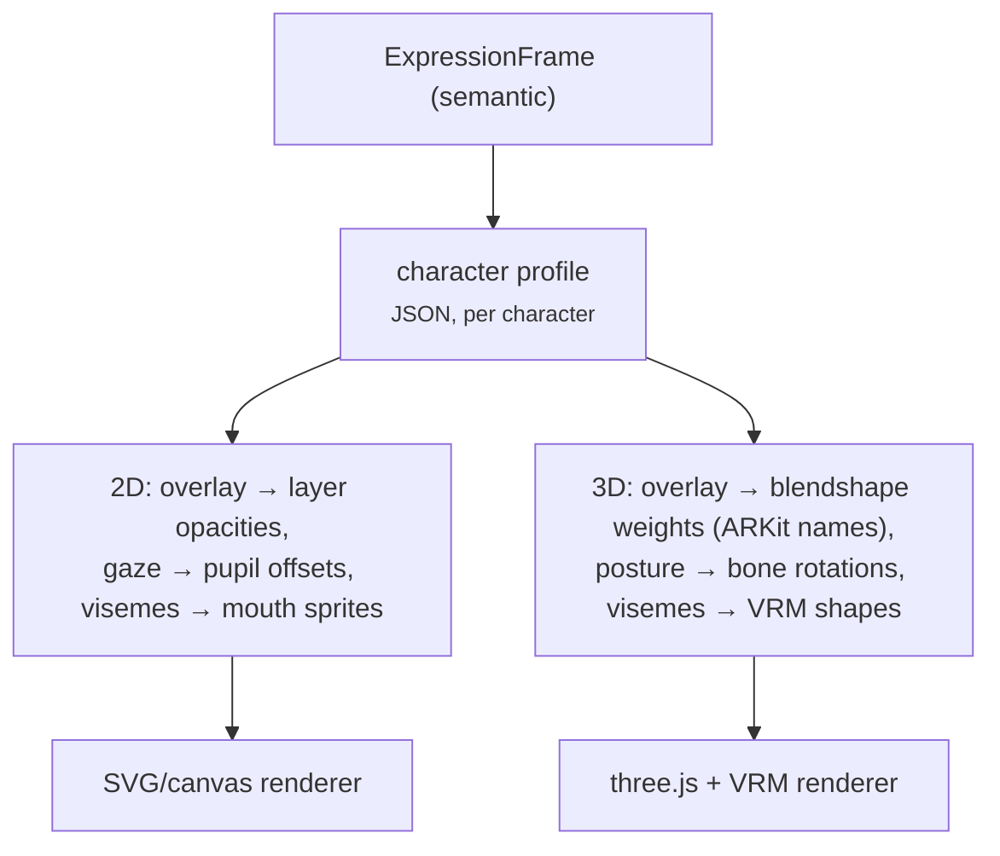
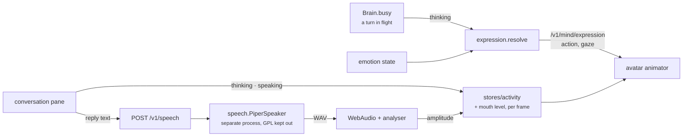
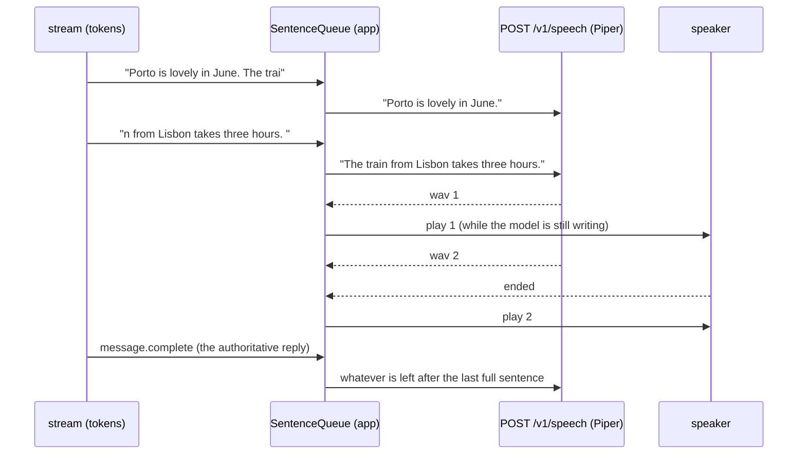

# 15 — Avatar Controller

**Status:** VRM renderer implemented (Milestone 10, [28](28-avatar-mvp.md)); 2D renderer, WebSocket frames, speech not yet · **Depends on:** [09](09-emotion-engine.md), [16](16-api-structure.md) · **Depended on by:** [18](18-frontend-architecture.md)

---

## 1. Purpose

The avatar is HEDWIG's face. The README states the key architectural constraint precisely:
*the avatar reflects internal state rather than directly following LLM outputs.* That single
sentence rules out the usual approach (asking the model to emit `[smiles]` tags) and
determines the whole design.

---

## 2. Why the avatar must not read the model's output

The tempting design is to have the model emit expression markup inline with its reply. It is
wrong for four reasons:

1. **It would make the avatar lie.** The model produces text conditioned on a prompt; the
   emotional state is a separate, durable, inspectable quantity. If the model says
   `[cheerful]` while `valence = −0.3`, the face and the system disagree, and the face is the
   part the user believes.
2. **It would be unbindable.** Emotion's whole justification is that it changes measurable
   behaviour (INV-3). Avatar expression is the most legible binding available. Routing it
   through model output severs it.
3. **It would be model-dependent.** Swap the model and the expressiveness changes, violating
   [01](01-vision-and-scope.md) §5.
4. **It would be brittle.** Markup leaks into replies, small models emit it inconsistently,
   and parsing it is a permanent tax.

So: **expression is derived from state**, deterministically, in code. The model's *content*
influences expression only through the appraisal that content already caused.

---

## 3. Architecture



The critical seam is `ExpressionFrame`: **semantic, not geometric.** The backend never emits
blendshape weights, bone rotations, or sprite indices. It emits *what is being expressed*, and
each renderer maps that to its own capabilities through a character profile.

---

## 4. The frame protocol

```jsonc
{
  "type": "expression.frame",
  "t": 1753900923.114,          // server monotonic seconds
  "seq": 48213,
  "mood": {                      // core affect, continuous
    "valence": 0.34,
    "arousal": 0.52
  },
  "overlay": {                   // named blend, weights sum ≤ 1
    "interest": 0.6,
    "warmth": 0.3,
    "fatigue": 0.1
  },
  "gaze": { "x": 0.12, "y": -0.05, "target": "user" },  // −1..1, or "away"/"thinking"
  "posture": { "lean": 0.2, "openness": 0.6, "energy": 0.55 },
  "action": { "kind": "speaking", "intensity": 0.5 },   // idle|listening|thinking|speaking|reacting
  "gesture": null,               // or {"kind":"nod","phase":0.3}
  "visemes": [                   // only while speaking, when available
    { "at": 0.02, "v": "AA", "w": 0.8 },
    { "at": 0.09, "v": "M",  "w": 0.9 }
  ],
  "blink": false
}
```

Design notes:

- **`mood` is the substrate; `overlay` is the nameable part.** This is exactly why core affect
  was added to the emotion vector ([09](09-emotion-engine.md) §3.1) — a renderer can do
  something reasonable with valence/arousal alone, and refine it with overlays it supports.
- **A renderer may ignore any field it cannot express.** The 2D renderer ignores `posture.lean`;
  the headless renderer ignores everything. Frames are advisory.
- **10 Hz, not 60 Hz.** The backend describes intent; the renderer interpolates and animates
  at display rate. Sending 60 frames/second of semantic state over a WebSocket would be
  wasteful and would still not be smooth without client-side interpolation.
- **`seq` allows drop detection**; frames are lossy by design ([04](04-communication-and-event-bus.md) §7).

### 4.1 Overlay vocabulary

Fixed, small, and every entry is derived from state — no overlay exists that the resolver
cannot produce:

`interest`, `warmth`, `amusement`, `concentration`, `uncertainty`, `fatigue`, `surprise`.

Explicitly absent: anger, sadness, fear, disgust — consistent with
[09](09-emotion-engine.md) §3.2. HEDWIG's face does not perform distress at the user. The most
negative available presentation is low-valence + fatigue + uncertainty, which reads as
"having a hard time" without being emotionally coercive.

---

## 5. Resolution and smoothing

`resolve(emotion, action, presence, personality) -> ExpressionIntent` is a **pure function**,
which means the entire expressive behaviour of the avatar is unit-testable without a renderer.

| Overlay | Formula (illustrative) |
|---|---|
| `interest` | `0.7·curiosity + 0.3·arousal` |
| `warmth` | `0.8·warmth + 0.2·max(0, valence)` |
| `amusement` | `happiness · humour_trait · playfulness_trait` |
| `concentration` | `action == thinking ? 0.5 + 0.4·arousal : 0.1` |
| `uncertainty` | `1 − confidence` |
| `fatigue` | `max(0, 0.5 − energy) · 2` |
| `surprise` | transient from `emotion.threshold.crossed` on novelty, 800 ms envelope |

Gaze: at the user while listening and speaking; away and upward while thinking (a small,
cheap cue that reads as deliberation); periodic saccades so it does not stare.

Smoothing uses a critically-damped spring per channel (time constants: mood 1.2 s, overlays
0.4 s, posture 2.0 s, gaze 0.15 s). Two reasons: emotion already publishes on a 30 s tick, so
a step change would be visible as a jolt; and different channels *should* move at different
speeds — eyes are fast, posture is slow. Getting that wrong is most of what makes digital
characters feel uncanny.

### 5.1 Idle behaviour

Generated by the scheduler, never by the resolver, because idle motion is stochastic and
resolution must stay pure:

| Behaviour | Rate |
|---|---|
| Blink | Poisson, mean 4 s, suppressed mid-viseme |
| Saccade | Poisson, mean 3 s, amplitude scaled by arousal |
| Breath | Sinusoid, period `4.5 − 1.5·arousal` seconds |
| Micro-shift | Every 20–60 s, small posture change |
| Attention drift | After 90 s idle, gaze wanders; returns instantly on user input |

Idle behaviour is what makes an avatar feel alive at rest. Its absence is immediately
noticeable; its presence is invisible. Worth building early and cheaply.

---

## 6. Speech and lip sync



Three degradation levels, all acceptable:

1. **Phoneme-accurate** — Piper (local, fast) gives phoneme timings; 15-viseme mapping.
2. **Amplitude-driven** — any TTS: jaw openness from the envelope. Surprisingly convincing.
3. **Text-paced** — no TTS at all: estimate syllables from streaming tokens and animate a
   generic talking motion. This is the Phase-6 default, because text-only HEDWIG still needs
   a mouth that moves in time with the words appearing.

Sync authority is the **client audio clock** when audio plays, because drift between audio and
mouth is the single most noticeable defect. When there is no audio, the token stream is the
clock.

---

## 7. Renderer independence



The character profile is data, not code:

```jsonc
{
  "name": "hedwig-default",
  "kind": "vrm",
  "overlay_map": {
    "interest":      { "browInnerUp": 0.6, "eyeWide": 0.3 },
    "amusement":     { "mouthSmile": 0.7, "cheekSquint": 0.4 },
    "concentration": { "browDown": 0.4, "eyeSquint": 0.2 }
  },
  "mood_map": { "valence": { "mouthSmile": 0.5 }, "arousal": { "eyeWide": 0.3 } },
  "viseme_map": { "AA": "vrm.A", "M": "vrm.M" },
  "limits": { "max_total_blend": 1.4 }
}
```

Consequences: a new character is a JSON file plus assets, not a code change. Swapping 2D for
3D changes nothing on the backend. And a renderer that cannot do posture simply omits the
mapping.

### 7.1 Phasing

| Phase | Renderer | Rationale |
|---|---|---|
| 6 | 2D layered SVG: eyes, brows, mouth, body tint | Expressive in days, not months; validates the frame protocol against something real |
| 7 | VRM via three.js | Once the protocol is proven, the renderer is a self-contained project |
| later | Unreal/Unity via a WebSocket bridge | The protocol is already renderer-agnostic; this is a client, not a redesign |

Starting 3D would be the classic mistake: months of rigging work before discovering the frame
protocol has the wrong fields. 2D first is not a compromise, it is how you find out.

> **Superseded in part by [ADR-0021](adr/0021-vrm-first-semantic-seam-kept.md):** Milestone 10
> built VRM first, keeping the seam this phasing protected — semantic intent from a backend
> resolver, mapped through a character profile.

---

## 8. Data and transport

Owns no tables. Expression frames are **not persisted** — they are derivable from
`emotion_history` plus the turn record, and 10 Hz of frames would be the largest table in the
database by an order of magnitude for no benefit.

Transport: the `expression.frame` message on the existing WebSocket
([16](16-api-structure.md) §5). Frames go **directly from the expression module to the WS hub,
bypassing the event bus** — an explicit, documented exception to
[04](04-communication-and-event-bus.md), because 10 Hz × durable outbox writes would be pure
waste. The bus still carries `avatar.expression.requested` at *intent* granularity (a few per
turn) for the inspector and for tests.

Emission stops entirely when no client is subscribed. An avatar animating for nobody is a
background CPU cost with zero value, and on a laptop that matters.

---

## 9. Tradeoffs

| Decision | Gained | Given up | Revisit if |
|---|---|---|---|
| State-driven, not model-driven | Honest face, model independence, testable | The avatar cannot react to reply *content* nuance beyond appraisal | Never |
| Semantic frames, not geometry | Renderer independence; new characters are data | An extra mapping layer | Never |
| 10 Hz + client interpolation | Bandwidth, CPU, still smooth | Fast transients need the envelope mechanism (surprise) | Renderers need finer input |
| Frames bypass the bus | No wasteful durable writes | An exception to the communication rules | Never; documented here and in ADR-0009 |
| Frames not persisted | No table growth | No exact replay of past expression | Emotion history is enough for the inspector |
| 2D before 3D | Protocol validated early and cheaply | Less impressive early demos | Never |
| No negative-emotion overlays | No emotional coercion of the user | Less dramatic range | Never |
| Pure resolver + separate stochastic idle | Fully testable expression logic | Two components instead of one | Never |
| Client audio clock as sync authority | No perceptible lip-sync drift | Client complexity | Never |

---

## 10. Failure modes

| Failure | Symptom | Mitigation |
|---|---|---|
| **Uncanny twitching** | Jittery face | Per-channel damping, `min_publish_delta` on emotion, frame-rate cap |
| **Frozen face** | Avatar stops moving | Idle scheduler always runs; a watchdog logs if no frame for 5 s while a client is connected |
| **Lip-sync drift** | Mouth trails audio | Audio clock authority, resync every 2 s, envelope fallback |
| **Emotion/face mismatch** | Face contradicts the inspector | Resolver is pure and tested; the inspector shows both state and resolved intent side by side |
| **Renderer starves the UI thread** | Whole page janks | Renderer budget (2 ms/frame), automatic quality reduction, hard 2D fallback |
| **WebSocket backpressure** | Frames queue and arrive late | Frames are lossy: drop rather than queue, keep only the newest |
| **Client without WebGL** | Blank avatar pane | Capability detection at load, 2D fallback, then a static portrait |
| **Battery drain** | Laptop fan spins during idle | Stop emitting when the tab is hidden or no client is subscribed; halve rate on battery |
| **Overlay conflict** | Muddy or broken expression | `max_total_blend` in the character profile; overlays normalised before mapping |

---

## 11. Testing

- **Resolver property tests** — the full state space (sampled) produces valid intents; every
  overlay stays in range; overlays never sum past the cap.
- **Smoothing tests** — a step input converges monotonically within the documented time
  constant; no overshoot past 5 %.
- **Golden frame sequences** — canonical scenarios (greeting after a week away, thinking,
  tool failure, late-night session) produce recorded frame sequences; regressions are diffs.
- **Headless mode test** — nothing in the system depends on a renderer existing (CLI must
  work).
- **Mapping validation** — every character profile is validated: all overlays and visemes in
  the vocabulary are mapped or explicitly declared unsupported.
- **Lip-sync timing test** — with recorded phoneme timings, viseme times fall within 40 ms of
  the audio.
- **Idle-behaviour statistics** — blink and saccade rates match their distributions over a
  simulated hour.
- **Load test** — 10 Hz frames for 10 minutes; assert no memory growth and no queue buildup.

---

## 12. Future improvements

| Improvement | Trigger |
|---|---|
| Full-body posture and gesture library | 3D renderer lands and posture data is under-used |
| Gaze following the user's cursor or camera | Only with explicit consent; camera access is a privacy decision, not a feature decision |
| Emotion-conditioned TTS prosody | TTS supports style parameters |
| Learned idle behaviour from character reference video | Well past Phase 7 |
| Expression during streaming reflecting confidence per clause | Requires per-token confidence, which we do not have |
| Multiple characters / user-selectable appearance | Character profiles already make this cheap; do it when someone asks |
| A "calm mode" that reduces all motion | Accessibility need, and it should probably be a Phase-6 setting rather than a future item |

---

## 13. Implementation record — thinking, speaking, voice (AVA-01, VOI-01, AVA-02)



* **Thinking (AVA-01).** `Brain.busy` is true while any turn holds or awaits its session lock
  (docs/07 §16). The resolver turns it into `action: thinking`, `gaze: thinking`, so a turn from
  the CLI makes the app's avatar think too. The animator looks up and aside and tilts the head
  slightly. The conversation pane also marks thinking locally, so the face reacts on the click,
  not on the next poll.
* **Speaking is the renderer's.** Only the renderer knows when audio is actually playing. A small
  shared store (`frontend/src/stores/activity.ts`) carries `idle | thinking | speaking` and a
  mouth level the render loop reads each frame without React re-renders (docs/18 §4 rule 3).
  Panes still never import each other.
* **Voice (VOI-01), decided with the user: Piper, local.** `Speaker` is a port, and
  `PiperSpeaker` its adapter. The maintained Piper (`piper-tts` 1.x, OHF-Voice) is **GPL-3.0**,
  so it is installed as its own tool (`uv tool install piper-tts`) and run as a separate process,
  never imported. HEDWIG stays MIT. Text goes in on stdin and WAV comes out through a temp file,
  with no shell and a timeout. The voice model lives in `<data_dir>/voices`.
* **What is spoken.** `speakable()` removes what should not be read aloud: citation markers
  `[1]`, URLs ("a link"), Markdown symbols. It caps the length.
* **Tone follows mood, within bounds.** Piper's `length_scale` is set from the emotional state:
  more arousal slightly faster, less energy slightly slower, clamped to 0.85–1.2. The voice
  reflects presentation without claiming feeling.
* **Mouth (AVA-02).** With audio, the mouth (`aa`) follows the live RMS amplitude from a WebAudio
  analyser, smoothed. Without voice, a text-paced movement (about 12 characters a second, capped
  at 6 s) stands in. Phoneme-accurate visemes need timing output Piper's CLI does not give
  (AVA-03).
* **Interruptions (part of VOI-03).** Sending a new message, or pressing *Stop*, stops playback at
  once.

| Tradeoff | Gained | Given up | Revisit if |
|---|---|---|---|
| Piper as a subprocess | Licence kept apart; replaceable; no model in the API process | ~0.1 s process start per reply | Latency matters: a long-lived Piper worker |
| Whole-reply WAV, not streaming | Simple, testable | Speech starts only after synthesis (~0.6 s a sentence) | Replies stream (FND-05) |
| Amplitude mouth | Works with any voice | Not true lip sync | AVA-03 |

**Verified live** in the app (browser pane, `gemma4:e2b`, Piper `en_US-lessac-medium`): voice on,
message sent, then *thinking* on the click, the reply, `POST /v1/speech` 200 through the proxy,
*speaking* with *Stop* shown, and idle when the audio ended. Synthesis: 5 s of speech in 0.48 s;
pace 0.86 when lively, 1.14 when tired. Known: a ~0.5 s idle moment between the reply and the
audio while Piper synthesises.

**Installing the voice** (once, outside HEDWIG's environment, GPL kept separate):

```bash
uv tool install piper-tts
~/.local/share/uv/tools/piper-tts/bin/python -m piper.download_voices en_US-lessac-medium --download-dir ~/.hedwig/voices
```

### 13.1 Mouth shapes from the words (AVA-03)

AVA-02 opened the mouth with the voice's loudness, always as `aa`. Now the *shape* comes from the
text being spoken: the playhead's position in the audio (or in the text-paced fallback) picks a
position in the words, and the vowel there — with common digraphs, "oo"/"ou" round, "ee"/"ea"
wide — picks one of VRM's five mouth shapes (`aa`, `ee`, `ih`, `oh`, `ou`). Loudness still sets
how open it is. `voice/visemes.ts`, pure and tested.

**Not phoneme timing.** Piper's command line gives no phoneme alignment, and its Python API would
pull GPL code into HEDWIG's process (docs/15 §13 keeps Piper a separate process for that reason).
Letter-based shapes are approximate — "though" is not "tow" — but a mouth that rounds on "you" and
widens on "see" reads as speech in a way one open-close shape did not. True phoneme timing waits
for a voice that reports alignments, behind the same `visemeAt` seam.

### 13.2 Listening (VOI-02)

Talking to HEDWIG instead of typing, entirely on this machine. A *Mic* button by the message box
records with the browser's `MediaRecorder`; pressing it again posts the recording once to
`POST /v1/speech/transcribe` (behind the token), where faster-whisper (`base.en`, int8 on CPU)
turns it into text in a worker thread. The text goes **into the message box**, not straight to
HEDWIG: recognition makes mistakes, and the user should see what will be sent. The audio is
never stored and never leaves the machine; the transcript becomes a message only if it is sent.

* **Setup** (done with the user's consent, 2026-11-23): `faster-whisper` (with PyAV pinned below 16,
  whose newer API faster-whisper 1.2 does not yet speak) and the `base.en` model (~145 MB) in
  `<data_dir>/voices/whisper`. The model is loaded with `local_files_only`: HEDWIG never downloads
  anything at runtime.
* **Without the model**, `GET /v1/speech` reports `listening: false` with the reason, the *Mic*
  button does not appear, and `hedwig doctor` says what to install.
* **Measured**: a 3.3-second spoken sentence transcribed word for word in 2.4 s the first time
  (loading the model) and 1.2 s after, through the API.
* **The desktop shell now refuses every permission but the microphone**, and that only for
  HEDWIG's own page. Electron grants everything by default; enabling a microphone use was the
  moment to stop granting camera, location and the rest.

**Future improvements.** Push-to-talk on a key; streaming recognition so words appear while
speaking; a larger model as an option; speaking the reply automatically when the message was
spoken.


---

## 14. Speaking as the reply streams (VOI-04)

§13 spoke a reply once it was complete: on a laptop CPU the first word was heard after the whole
reply had been generated *and* synthesised. The words already arrive token by token (FND-05), and
Piper synthesises a sentence in about 0.6 s, so the first sentence can be heard while the rest is
still being written.



* **In the app, not the server.** The server already streams tokens and synthesises any text on
  request; the queue is a client concern — which sentences, in what order, stopped when — so
  nothing on the server changes and REST clients keep the whole-reply behaviour.
* **Sentences, deterministically.** A sentence ends at `.`, `!`, `?` or `…` (with closing quotes
  or brackets) followed by whitespace, or at a blank line — not after a common abbreviation
  ("Dr.", "e.g.") and not until it has a dozen characters, so "Hi." does not cost a synthesis
  of its own. `voice/sentences.ts`, tested on its own.
* **Synthesis runs ahead, one at a time; playback runs in order.** Each sentence goes to Piper
  once it is complete *and* the sentence before it has been synthesised; playback waits for its
  turn. Measured live: sent all at once, three sentences synthesised side by side took 0.5–0.84 s
  each against 0.3 s alone — the first sentence, the one that matters, got slower. One at a time,
  each takes ~0.25 s, far ahead of the seconds it takes to say.
* **The final reply settles the rest.** `message.complete` is authoritative (ADR-0023): what it
  has beyond the sentences already spoken is spoken. If it differs from what streamed (a turn cut
  short adds its note), only the part after the spoken prefix is said; nothing is said twice.
* **One owner of the mouth.** While audio plays, the player moves the mouth from its amplitude;
  arriving tokens stop moving it (they did before, when nothing was spoken yet). The face stays
  *speaking* between sentences instead of flickering to idle.
* **Stop stops everything** — the sentence playing, the ones queued and the requests in flight
  (VOI-03). A new message stops the last reply's voice before anything else. A sentence whose
  playback fails (no audio device) is skipped; the rest still get their turn.
* **Push-to-talk.** Holding *Mic* records while held and sends what was heard on release; a
  click still records until the next click and puts the words in the box to check first. The
  keyboard keeps the click behaviour.
* **The microphone says whether it is recording** (after review). `useMicrophone` keeps its own
  phase — idle, starting, recording, transcribing — and exposes `start` and `stop`; the
  composer decides from that, never from its own guess. So a refused permission leaves the next
  press a fresh start; a second start while the first is still waiting for permission opens no
  second recorder; and a release that comes before the microphone has started is kept and
  applied the moment it starts, so a quick press-and-release never leaves a recorder running.
  Only the first such stop is kept — it is the held release waiting for its words; a later one
  gets nothing. A recorder that will not start after the microphone opened closes the
  microphone again and leaves it idle.
  The button captures its pointer, so letting go outside it still ends the press; a press the
  browser takes over (`pointercancel`) stops and sends nothing. If what was heard could not be
  sent, it is put in the box, as a typed message is.
* **A failed turn ends its voice.** A turn that fails after its first sentence was spoken has no
  reply to finish the queue with; the conversation now says so (`onFailed`) and the voice stops,
  so the face does not stay *speaking*. And a stopped queue gives up the shared *voiced* state
  only once: its chain settling later cannot take it from the next reply's queue.

| Tradeoff | Gained | Given up | Revisit if |
|---|---|---|---|
| Sentence granularity | Natural pauses; one Piper call each | The first sentence waits for its full stop | Long first sentences: split at commas past ~80 characters |
| Client-side queue | No server change; REST unaffected | Each client implements it | A second voice client appears |
| One Piper process per sentence | Unchanged adapter (§13) | ~0.1 s process start each | A long-lived Piper worker |
| One synthesis at a time | The first sentence is never slowed by the others | Less parallelism on a many-core machine | Piper runs as a worker with its own threads |

**Measured live** (`gemma4:e2b`, Piper `en_US-lessac-medium`, the app in the browser pane): a
ten-sentence story, 571 characters. The reply finished streaming at +1.81 s; the first sentence
was synthesised and ready at **+0.81 s**, and the next nine followed at ~0.25 s each. Speaking the
whole reply as before would have started at +1.81 s plus 1.05 s of synthesis — about **+2.9 s**.
On a two-sentence reply that a warm model writes in 0.7 s the difference is negligible; the
gain grows with the reply.

**Still not built:** phoneme-accurate timing (§13: Piper's command line gives no alignment, and
its Python API would bring GPL code into HEDWIG's process).
