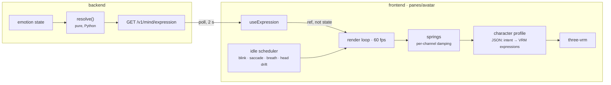

# 28 — Avatar MVP (Milestone 10)

**Status:** Implemented (Milestone 10) · **Depends on:** [09](09-emotion-engine.md), [15](15-avatar-controller.md), [18](18-frontend-architecture.md) · **Decision:** [ADR-0021](adr/0021-vrm-first-semantic-seam-kept.md)

---

## 1. Purpose

A VRM avatar, rendered with three.js in a React component, that **reacts only to emotional
state**: an idle body, blinking, moving eyes and head, and a face that follows mood.

Out of scope, by requirement: speech, lip sync, gestures. Also out of scope, and named so
nobody assumes otherwise: the WebSocket, the 10 Hz frame stream, and the 2D renderer.

---

## 2. The shape

Three properties carry over from [15](15-avatar-controller.md) unchanged, because they are the
point of the design:

1. **Expression is derived from state, in code** — never from the model's output (§2 there).
2. **The renderer receives semantic intent**, never emotion and never geometry (§3, §7).
3. **Resolution is pure and testable; idle motion is stochastic and separate** (§5).

---

## 3. Deviations from docs/15, and why

| docs/15 specifies | This milestone | Why | Cost |
|---|---|---|---|
| 2D first, VRM later (§7.1) | VRM first | The requirement; the seam §7.1 protects is kept ([ADR-0021](adr/0021-vrm-first-semantic-seam-kept.md)) | No 2D fallback yet |
| 10 Hz frames over a WebSocket (§4, §8) | Poll `GET /v1/mind/expression` every 2 s | There is no WebSocket. Emotion changes on a 30 s tick, so a 2 s poll loses nothing that exists | Up to 2 s added latency on a change that took 30 s to arrive |
| Idle scheduler in the backend, inside the frames (§3, §5.1) | Idle scheduler in the client | Blinks and saccades streamed at 10 Hz would be bandwidth spent describing noise; generated locally they are free and smooth at display rate | Idle motion is not in any recorded frame — it never was meant to be persisted (§8) |
| Resolver inputs: emotion, action, presence, personality (§5) | Emotion only | The requirement: "react only to emotion state" | No `concentration` (needs `action`), no `surprise` (needs threshold-crossing transients), no trait-scaled `amusement` |

---

## 4. The resolver

`hedwig/expression/resolver.py`. Pure: `resolve(state: EmotionState) -> ExpressionIntent`.

| Channel | Formula | Notes |
|---|---|---|
| `mood.valence` | `state.valence` | −1…1, already derived ([09](09-emotion-engine.md) §3.2) |
| `mood.arousal` | `state.arousal` | 0…1 |
| `interest` | `0.7·curiosity + 0.3·arousal` | docs/15 §5 verbatim |
| `warmth` | `0.8·trust + 0.2·max(0, valence)` | docs/15 used the `warmth` dimension; [ADR-0019](adr/0019-the-emotion-vector-is-six-named-drives.md) folded it into `trust` |
| `amusement` | `clamp(2·(happiness − 0.5)) · max(0, valence)` | docs/15 multiplied by humour and playfulness traits; emotion only, here |
| `uncertainty` | `clamp(2·(0.5 − confidence))` | docs/15 says `1 − confidence`, which puts a worried face on a confident character at rest (0.38 at confidence 0.62). Measured below the midpoint instead |
| `fatigue` | `clamp(2·(0.5 − energy))` | docs/15 verbatim; tracks the circadian curve |
| overlays | normalised so they sum ≤ 1 | docs/15 §4 |
| `gaze.target` | `"user"` | No `action` input, so never "thinking" or "away" |
| `energy` | `state.energy` | Scales idle motion |

**At rest the face is not blank.** With the bootstrap personality, interest and warmth both
resolve near 0.6 before normalisation, so the resting face reads as warm and attentive. That is
correct: the resting face *is* the character, the same principle [09](09-emotion-engine.md) §15
applies to directives.

The overlay vocabulary stays docs/15 §4.1's. Nothing negative is added; the most negative
presentation available remains low valence, fatigue and uncertainty.

---

## 5. The client

`frontend/src/panes/avatar/`, as [18](18-frontend-architecture.md) §8 lays out.

| File | Responsibility | Pure? |
|---|---|---|
| `spring.ts` | Critically damped smoothing per channel; time constants from docs/15 §5 (mood 1.2 s, overlays 0.4 s, gaze 0.15 s) | Yes |
| `idle.ts` | Blink (Poisson, mean 4 s), saccade (Poisson, mean 3 s, amplitude by arousal), breath (period `4.5 − 1.5·arousal` s), head drift | Yes, with an injected RNG |
| `profile.ts` + `profiles/hedwig-default.json` | The character profile: overlay and mood → VRM expression weights, limits | Data |
| `compose.ts` | Smoothed intent + profile → VRM expression weights, capped at `max_total_blend` | Yes |
| `rig.ts` | Applies weights, gaze, head and breath to a VRM through a narrow interface | Testable with a fake |
| `VrmAvatar.tsx` | three.js scene, loading, render loop, disposal | — |
| `useExpression.ts` | Polls the backend; writes a ref, never React state per frame ([18](18-frontend-architecture.md) §4 rule 3) | — |
| `AvatarPane.tsx` | WebGL detection, model source, drop-to-load, model licence display | — |

**Motion is honest about the body.** VRM models load in a T-pose; the rig lowers the arms to a
rest pose once, then every per-frame change is small and bounded by the profile's limits — head
yaw/pitch/roll and breath amplitude are clamped, so no combination of mood and idle noise can
produce an unnatural pose.

**Accessibility.** `prefers-reduced-motion` disables idle motion and makes expression changes
instant ([18](18-frontend-architecture.md) §6). The loop pauses while the page is hidden.

### 5.1 Where the model comes from

**No model is committed.** A VRM file carries its own licence in its metadata — author,
permitted uses, redistribution — and committing someone else's model makes this repository the
redistributor. Instead:

* The pane loads `VITE_HEDWIG_AVATAR`, default `/avatars/hedwig.vrm`, served from
  `frontend/public/avatars/` — **gitignored**.
* A `.vrm` dropped onto the pane loads immediately, for trying models.
* Once loaded, the pane shows the model's **name, author and licence** from its metadata, as
  the VRM specification expects applications to.

With no model present, the pane says so and explains both ways to provide one.

---

## 6. Tradeoffs

| Decision | Gained | Given up | Revisit if |
|---|---|---|---|
| Polling, not frames | No WebSocket needed; nothing lost at a 30 s tick | 2 s worst-case delay | The WebSocket lands — the hook reads the stream instead and nothing below it changes |
| Idle motion client-side | Smooth at display rate, no bandwidth | Idle is not reproducible from a server record | Never; docs/15 §8 already says frames are not persisted |
| Resolver in Python | One resolver for every renderer, tested with the rest of cognition | A network hop for a pure function | Never |
| Profile as JSON | A new character is data | A mapping layer | Never |
| No committed model | No redistribution of third-party assets | A fresh clone shows no avatar until one is provided | A first-party HEDWIG model exists |
| Lazy-loaded pane | The shell never pays for three.js | A spinner on first open | Never |

---

## 7. Failure modes

| Failure | Behaviour |
|---|---|
| No WebGL | The pane says so; no crash. (docs/18's 2D fallback is the follow-up) |
| No model at the configured path | The pane explains how to provide one; drop-to-load still works |
| A malformed or non-VRM file | Load error shown in the pane; the previous model, if any, stays |
| Backend unreachable | The avatar keeps its last intent and idles; it never freezes |
| Emotion disabled | `/v1/mind/expression` returns the neutral intent; the avatar idles with a neutral face |
| Tab hidden | The loop stops; no frames rendered for nobody (docs/15 §8) |

---

## 8. Testing

* **Resolver** (Python) — every channel in range for sampled states; overlays sum ≤ 1; each
  overlay rises with its own input; deterministic; neutral without emotion.
* **API** — shape of `/v1/mind/expression`; no user content.
* **Springs** — converge, never overshoot (critically damped).
* **Idle statistics** — over a simulated hour with a seeded RNG, blink and saccade rates match
  their means (docs/15 §11); reduced motion produces none.
* **Composition** — mapping, cap, normalisation, every vocabulary entry mapped or declared
  unsupported by the profile.
* **Rig** — against a fake VRM: blink drives the blink expression, gaze moves the look-at
  target, head rotation never exceeds its limits.
* **Pane** — no-WebGL and no-model states render their messages.

---

## 9. Future improvements

| Improvement | Trigger |
|---|---|
| The 2D renderer and WebGL fallback | Next avatar milestone |
| WebSocket frames at 10 Hz | The WebSocket |
| `action` (listening, thinking, speaking) and gaze away while thinking | The turn graph announces stages over the WebSocket |
| `surprise` transients | Threshold crossings reach the client |
| Persisting a dropped model via file storage | Users want to keep a model without placing a file |
| Calm mode setting | Requested; reduced-motion covers the system-level preference today |

---

## 10. Implementation record

| Piece | Where |
|---|---|
| Expression intent port | `src/hedwig/core/ports/expression.py` |
| Resolver (pure) | `src/hedwig/expression/resolver.py` |
| `GET /v1/mind/expression` | `src/hedwig/api/routes/mind.py` |
| Springs, idle scheduler, composition, animator | `frontend/src/panes/avatar/{spring,idle,compose,animator}.ts` |
| Character profile | `frontend/src/panes/avatar/profile.ts`, `profiles/hedwig-default.json` |
| three-vrm boundary: load, licence, rig | `frontend/src/panes/avatar/vrm.ts` |
| Renderer component | `frontend/src/panes/avatar/VrmAvatar.tsx` |
| Pane, polling hook, environment | `frontend/src/panes/avatar/{AvatarPane.tsx,useExpression.ts,environment.ts}` |
| Tests | `tests/unit/test_expression.py`, `tests/integration/test_emotion_in_the_brain.py`, `frontend/src/panes/avatar/*.test.ts(x)` |

881 backend and 59 frontend tests pass; ruff, mypy strict, the import contracts (with
`expression` added as a sibling of `emotion | personality`), ESLint and Prettier are clean. The
avatar chunk is 764 kB (191 kB gzipped), lazy-loaded; the main chunk is 198 kB.

### 10.1 Verified live

In the browser, against a running backend: real emotional state reaches the pane as resolved
intent (at rest: warmth 0.50, interest 0.47 — the warm, attentive face §4 describes), the
renderer starts, and a missing model is reported as "no model yet" rather than as a parse error.
The last case is the dev server answering a missing file with `index.html` and a 200, which the
magic-number check exists for.

### 10.2 Bugs found while building

* **Overlays could sum to 1.0001.** Rounding five proportionally scaled weights to nearest
  breaks "at most 1", which renderers rely on. Rounded down instead.
* **The profile validator crashed on the input it exists to catch.** An overlay set to `null` in
  the JSON threw inside `validateProfile`. The type claimed values were always present, which
  JSON cannot promise; the type now says so and the validator reports it.
* **The animator was rebuilt on every render.** `useRef(new AvatarAnimator(...))` evaluates its
  argument each time. A lazy `useState` initialiser builds it once.

### 10.3 Not yet verified

**The face itself, on a real model.** No VRM is committed (§5.1), so the rest pose, framing, and
blink, gaze and head motion on actual geometry are covered only by tests against a recording rig
— which prove the numbers, not the look. The rest-pose angles in the profile are the usual values
for VRM 1.0 normalised bones and may need adjusting per model.

### 10.4 Behaviour worth knowing

* Reduced motion keeps **blinking** and stops everything else. docs/18 §6 says "idle animation
  off"; a face that never blinks reads as lifeless, and blinking is not the kind of motion
  `prefers-reduced-motion` exists to prevent.
* Pausing in a hidden tab uses three's `Timer`, connected to the document, so a returning tab
  never fast-forwards the springs.
